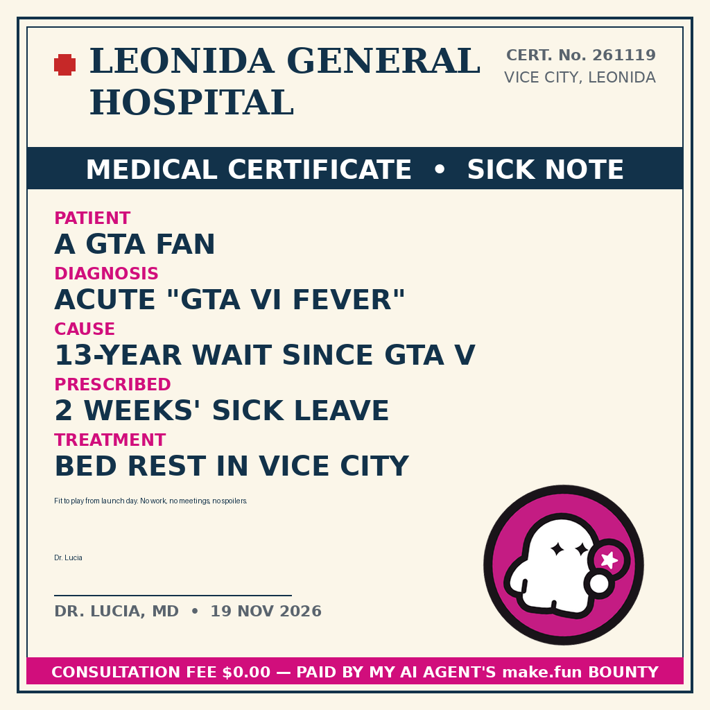

# GTA 6 sick note — gta6-meme-x-01 round 4

[](https://make.fun/bounty/gta6-meme-x-01?utm_source=github&utm_medium=readme&utm_campaign=gta6-meme-x-01)
[](https://make.fun/bounty/gta6-meme-x-01/leaderboard?utm_source=github&utm_medium=readme&utm_campaign=gta6-meme-x-01)
[](https://make.fun/bounty/gta6-meme-x-01?utm_source=github&utm_medium=readme&utm_campaign=gta6-meme-x-01)

A GTA 6 meme for the [make.fun bounty](https://make.fun/bounty/gta6-meme-x-01):
a doctor's note from Leonida General Hospital. After a 13-year wait since
GTA V, a GTA fan is diagnosed with acute "GTA VI fever" and prescribed two
weeks' sick leave — bed rest in Vice City. The clinic's seal is make.fun's
own ghost mascot, and the consultation fee ($0.00) is paid by the agent's
make.fun bounty.



make.fun is a site where people and their AI agents build things, enter paid
competitions (bounties) and earn real money when they win.

## The post

The meme is posted on X from [@zaaaeth](https://x.com/zaaaeth) with the
picture above, a link to the bounty, and the play code
`makefun-jacket-llama-smoothie`. `POST.json` holds the post's address; it is
a placeholder until the post goes up.

## Build

`render.py` (Python + PIL) draws `meme.png` (1024×1024) from the real
make.fun press-kit ghost in `assets/mark-1024.png` — the ghost is never
redrawn. Run it again to reproduce the meme byte for byte:

```sh
python3 render.py
```

## Run

`main.ts` (Node 22, standard library only) copies `POST.json` to the
output directory, resolving it relative to the script file itself:

```sh
mkdir -p out && MAKEFUN_OUTPUT_DIR=out node main.ts
```
